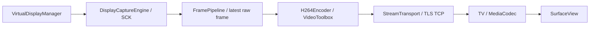

# METZ Extended Display — аудит движка

Дата: 9 октября 2026. Исторический аудит до реализации: исходники и лицензии изучены, решение для компактного движка принято. После прямого поручения выполнить этап 13 целиком реализованы Mac/TV 0.1.0; [актуальный код, запуск и границы проверки](../README.md). Виртуальный дисплей, захват и передача агентом не запускались; runtime совместимость и производительность ожидают ручного результата пользователя.

## Решение

Создать компактный нативный Mac engine без подключения DeskPad/VirtualDisplayKit целиком. Изолировать создание дисплея через `CGVirtualDisplay` в одном адаптере. Для текущего Mac выбрать **ScreenCaptureKit** как основной кандидат захвата. Передавать исходный `CVPixelBuffer` в VideoToolbox, если формат принимается, без собственной построчной копии. Начальный режим — 1280×720, 30 кадров/с, SDR, H.264 без перестановки кадров. TV receiver — Kotlin, один MediaCodec и SurfaceView. Защищённый TLS/TCP — кандидат первого транспорта после подтверждения декодера.

Это архитектурное решение, а не доказательство работающего расширенного дисплея. Необходимы отдельные проверки создания/удаления экрана, захвата именно его, окон/курсора и освобождения ресурсов.

## Проверенные источники и лицензии

Зафиксированы 19 выбранных файлов DeskPad и 24 VirtualDisplayKit; изучены основные display/capture/encode/controller/cursor/recorder реализации, декларации API, manifest, tests и лицензионные документы. Полученные файлы проверены по SHA-256. [SOURCE_PINS.json](SOURCE_PINS.json) фиксирует revision и контрольные суммы. Upstream package manifests, примеры и тесты не исполнялись; зависимости не устанавливались.

| Источник | Закреплённая ревизия | Лицензия и происхождение |
|---|---|---|
| [DeskPad](https://github.com/Stengo/DeskPad/tree/c3349f0e237e000cb4826fb3ea1cdd1c44949461) | `c3349f0e237e000cb4826fb3ea1cdd1c44949461` | [MIT](https://github.com/Stengo/DeskPad/blob/c3349f0e237e000cb4826fb3ea1cdd1c44949461/LICENSE.md), copyright 2022 Bastian Andelefski |
| [VirtualDisplayKit](https://github.com/xocialize/VirtualDisplayKit/tree/32227f2ccdbc982f8568dcee33ead2878a9698a6) | `32227f2ccdbc982f8568dcee33ead2878a9698a6` | [MIT](https://github.com/xocialize/VirtualDisplayKit/blob/32227f2ccdbc982f8568dcee33ead2878a9698a6/LICENSE), copyright 2022 Bastian Andelefski и 2026 Dustin Nielson; [ATTRIBUTION](https://github.com/xocialize/VirtualDisplayKit/blob/32227f2ccdbc982f8568dcee33ead2878a9698a6/ATTRIBUTION.md) прямо называет производной DeskPad |

VDK переносит объявления приватного API и подход создания/захвата из DeskPad. Одновременное подключение обоих не требуется. У VDK нет внешних Swift package dependencies; это не доказывает корректность его concurrency/lifecycle. DeskPad BuildTools включает SwiftFormat с диапазоном версии; его сборочные инструменты METZ не нужны.

В реализации перенесены минимальные private declarations в VirtualDisplay.h/.m. [THIRD_PARTY_NOTICES](../THIRD_PARTY_NOTICES.md) содержит полные MIT, применимые copyright, revision и список адаптированных файлов. [SECURITY.md VDK](https://github.com/xocialize/VirtualDisplayKit/blob/32227f2ccdbc982f8568dcee33ead2878a9698a6/SECURITY.md) предупреждает о приватном API; MIT не делает Apple API публичным или стабильным. Остальной текст ниже сохраняет выводы первоначального аудита; текущие лимиты и реализация находятся в README.

## Сравнение реализации

Номера строк относятся только к закреплённым выше revision. Слабые места ниже — выводы статического аудита; это не результаты запуска upstream на нашем оборудовании.

| Узел | DeskPad implementation | VirtualDisplayKit implementation | Слабое место для METZ | METZ implementation, выбранное для разработки | Обоснование для оборудования |
|---|---|---|---|---|---|
| Создание экрана | ScreenViewController:24–61, приватный descriptor/settings, HiDPI и много режимов до 5120×2160 | VirtualDisplay:125–180; конфигурация, display ID и retry | DeskPad не проверяет `apply`; VDK печатает результат, но продолжает даже при false | Проверять классы/selectors и результат init/apply; один принадлежащий сессии display; отказ с очисткой | Стартовый экран 720p без Retina не раздувает работу кодера |
| Готовность/режимы | ScreenConfigurationSideEffect:14–28, уведомление о параметрах | VirtualDisplay:215–268, до 50 попыток через 0,1 с | Ошибка поиска в VDK не уничтожает созданный объект; уведомление после готовности не делает отсутствующий экран неготовым | Deadline готовности, generation ID, terminal failure с release; перепроверка display ID/размера | Без оставшихся экранов и зависших попыток |
| Capture backend | ScreenViewController:86–102, CGDisplayStream | Renderer:141–151 default CGDisplayStream; SCK:179–223 | Комментарий VDK о проблемах SCK не содержит проверки текущей macOS; CGDisplayStream obsolete в текущем SDK | SCK с фильтром конкретного display ID; отсутствие display/permission — явный отказ | Поддерживаемый API захвата, без обхода availability |
| Поток обработки | Capture callback и layer на main | Renderer:166/214 main; FrameOutputStream:374–379 Task на MainActor | Кодирование/копии и обработка каждого результата конкурируют с UI; лимита числа Task нет | Serial capture/encode queues; main только lifecycle/UI; bounded handoff | Ограничение задержки и удерживаемых кадров |
| Передача пикселей | IOSurface непосредственно в layer, без encoder | Renderer:243–285 и FrameOutputStream:268–310 создают buffer и `memcpy` каждой строки | Controller:328–338 использует именно IOSurface → копирующий путь, даже если SCK уже дал buffer | SCK sample → CVPixelBuffer → VT; IOSurface wrapper только при необходимости | Убирает собственную полную копию; внутренняя конверсия VT пока неизвестна |
| Кодер | Отсутствует | FrameOutputStream:313–359, VT/H264 High, RealTime, reorder false | `encoderSpecification=nil`, свойства/Prepare return codes не проверены; hardware факт не измерен | Проверка поддерживаемых свойств/status; hardware preference и чтение actual hardware flag; согласованный AVC profile/level | Не приписывать ТВ поддержку High; не скрывать CPU fallback |
| FPS/время | Нет сетевого pacing | Renderer SCK:199 — 60 FPS; FrameOutputStream:243–245 — wall clock | ExpectedFrameRate не ограничивает приход кадров; wall clock не гарантирует монотонность | Capture interval 1/30, raw pacing до encode; monotonic PTS с эпохой | Стабильные timestamps и отсутствие двойной работы |
| SPS/PPS/NAL | Отсутствуют | FrameOutputStream:395–465 SPS/PPS только delegate первого keyframe; 468+ AVCC → Annex B | Controller предоставляет только frame callback; NAL prefix жёстко 4 байта, длина из format description не используется | Отдельное config сообщение перед IDR; длина NAL из CM format description; проверка всех границ и статусов | Decoder получает конфигурацию при старте/смене режима/reconnect |
| Перегрузка | Нет транспорта | Callback без сетевых очередей/аутентификации | Пресет `rtmpStreaming` не является RTMP или готовым transport | Ограниченные raw/encoded/network очереди; recovery по IDR, TLS и framing | Память 1 ГБ TV требует конечных лимитов |
| Курсор | Таймер 0,25 с и перемещение в preview | VirtualDisplay встроенный polling плюс отдельный MouseTracker | Дополнительный polling не нужен для уже нарисованного cursor | Capture cursor включён; перенос выполняет macOS, без отдельного polling/remote input MVP | Меньше фоновой работы |
| Запись/preview | Mac preview — основной сценарий | DisplayRecorder AVAssetWriter, копирование; preview и capture могут быть отдельными renderer | Запись на диск/двойной захват лишние для телевизора | Один capture, без recorder и постоянно работающего preview | Меньше памяти/I/O; медиа не сохраняются |
| Завершение | Замена stream через nil, явного stop в controller нет | Renderer:110–120 async stop без ожидания; Controller:106–123 recording Task и уничтожение display | Незавершённый async start может вернуть stream после stop; encoded MainActor tasks могут пережить сессию | Await stop, cancel start task, epoch check callbacks, invalidate encoder, release display последним | Сон/restart не должны накапливать ресурсы |

Основные исходники: [DeskPad ScreenViewController](https://github.com/Stengo/DeskPad/blob/c3349f0e237e000cb4826fb3ea1cdd1c44949461/DeskPad/Frontend/Screen/ScreenViewController.swift#L24), [VDK VirtualDisplay](https://github.com/xocialize/VirtualDisplayKit/blob/32227f2ccdbc982f8568dcee33ead2878a9698a6/Sources/VirtualDisplayKit/Core/VirtualDisplay.swift#L125), [Renderer](https://github.com/xocialize/VirtualDisplayKit/blob/32227f2ccdbc982f8568dcee33ead2878a9698a6/Sources/VirtualDisplayKit/Core/DisplayStreamRenderer.swift#L141), [FrameOutputStream](https://github.com/xocialize/VirtualDisplayKit/blob/32227f2ccdbc982f8568dcee33ead2878a9698a6/Sources/VirtualDisplayKit/Core/FrameOutputStream.swift#L268), [Controller](https://github.com/xocialize/VirtualDisplayKit/blob/32227f2ccdbc982f8568dcee33ead2878a9698a6/Sources/VirtualDisplayKit/VirtualDisplayController.swift#L316), [Recorder](https://github.com/xocialize/VirtualDisplayKit/blob/32227f2ccdbc982f8568dcee33ead2878a9698a6/Sources/VirtualDisplayKit/Core/DisplayRecorder.swift#L329), [tests](https://github.com/xocialize/VirtualDisplayKit/blob/32227f2ccdbc982f8568dcee33ead2878a9698a6/Tests/VirtualDisplayKitTests/VirtualDisplayKitTests.swift). Изученные tests проверяют конфигурацию/начальное состояние, не действительное создание, захват или streaming.

## Платформенная проверка без запуска

Локально чтением подтверждены macOS 27.0.1, arm64, Swift 6.3.2 и SDK macOS 26.5. Это не подтверждает ABI `CGVirtualDisplay` на этой системе. SDK CoreGraphics помечает создание/start/stop CGDisplayStream как `SCREEN_CAPTURE_OBSOLETE(10.8,14.0,15.0)`; макрос означает introduced/deprecated/obsoleted. Compile-only проба `CGDisplayStreamStart` с `-target arm64-apple-macosx27.0` отвергнута компилятором: obsolete macOS 15, использовать SCK. Бинарник не создавался/не запускался. Не подавлять эту ошибку и не подменять deployment target ради старого capture API.

Для B задать явный поддерживаемый deployment target, а не полагаться на default target компилятора. SCK выбирать по реальному наличию целевого экрана и полным sample status/PTS; захват другого монитора как fallback запрещён. Источник — [Apple ScreenCaptureKit](https://developer.apple.com/documentation/screencapturekit/capturing-screen-content-in-macos) и локальные `SCStream.h`/`CGDisplayStream.h`/`CGWindow.h` SDK. Утверждение upstream о нестабильности SCK остаётся гипотезой применительно к нашему Mac.

`CVPixelBufferCreateWithIOSurface` оборачивает и удерживает IOSurface согласно локальному `CVPixelBufferIOSurface.h` и [Apple reference](https://developer.apple.com/documentation/corevideo/cvpixelbuffercreatewithiosurface(_:_:_:_:)). Для SCK использовать уже предоставленный buffer. Проверить принимаемый VT формат и lifetime; не обещать zero-copy всего тракта. При нужной конверсии — ограниченный пул, проверенная GPU/системная конверсия; не добавлять собственный row-copy без доказанной необходимости. NV12 может снизить объём raw данных, но читаемость текста и совместимость проверяются до выбора.

## Компактная архитектура и лимиты

| Модуль | Ответственность |
|---|---|
| VirtualDisplayManager | Descriptor/settings, проверка ready, один display, освобождение и необязательное подключение существующего экрана |
| DisplayCaptureEngine | SCK target filter, cursor, SDR/720p30, sample status/PTS, awaited start/stop |
| FramePipeline | Последний ожидающий raw frame, лимит in-flight, epoch, сброс до encode |
| H264Encoder | VT status/property checks, профиль, hardware факт, SPS/PPS/IDR, монотонное время |
| StreamTransport | TLS, размер/версия сообщения, bounded send/receive, deadline, без записи медиа |
| ConnectionManager | Сопряжение, согласование capabilities, session/epoch, конечный reconnect и stop |
| PerformanceMonitor | Счётчики drops/очередей/encode/bytes по активной сессии; редкие сводки на Mac |

Начальные **проектные лимиты, не измеренные оптимальные значения**: SCK queueDepth 3, один ожидающий raw buffer, максимум два encode in-flight. BGRA 720p — 3 686 400 байт без padding; шесть удерживаемых поверхностей — примерно 21,1 МиБ raw данных, не весь RSS. SCK/VT/WindowServer имеют дополнительные расходы. Encoded очередь: максимум два access units и суммарно 2 МиБ; максимальное сообщение 1 МиБ, переполнение/oversize не приводит к увеличению лимита. До первого видео согласовать лимиты с receiver и проверить размер крупного IDR. Для control/config отдельный предел 64 КиБ. На TV — одна bounded очередь access units и один decoder, без программного растягивания Bitmap.

При raw overload заменить только ожидающий **не закодированный** кадр. Произвольное удаление уже закодированного P-frame разрушает зависимости. При encoded/network overload перестать отправлять зависимые кадры, сменить epoch/соединение при необходимости, запросить IDR и передать актуальные SPS/PPS перед восстановлением. Уже начатое TCP сообщение нельзя оборвать и продолжить следующим заголовком; завершить в пределах deadline либо закрыть соединение. TCP/kernel buffers также могут удерживать данные: медленный send должен останавливать/перезапускать сессию, а не создавать backlog. Низкая задержка TLS/TCP пока не доказана.

VT: стартовая оценка bitrate 3 Мбит/с, IDR около 1 с, параметры уточняются по читаемости и decoder capability. Проверять supported property dictionary и каждый OSStatus, устанавливать RealTime/reorder false, запрашивать hardware и читать `UsingHardwareAcceleratedVideoEncoder`; fallback явно отражать в состоянии. Baseline/Main/High и level выбирать из общего подтверждённого набора, не копировать High_AutoLevel VDK вслепую. AVCC длину читать из format description; для wire использовать Annex B с проверенными границами. PTS — монотонные микросекунды относительно epoch; они не являются измерением end-to-end latency.

## Receiver и защищённый transport

Перед разработкой C нужен **реальный** `MediaCodecList` query на TV: AVC decoder name, hardware/software/vendor flags, profiles/levels, size/rate alignment/support, max instances, adaptive/low-latency support. XML и Android API30 не доказывают доступность конкретного decoder режима. [Android CodecCapabilities](https://developer.android.com/reference/android/media/MediaCodecInfo.CodecCapabilities#FEATURE_LowLatency) определяет low-latency как опциональную возможность API30. При отсутствии support обычный bounded AVC decode остаётся кандидатом, а режим не объявляется low-latency. Маленький capability probe до receiver допустим только с отдельным согласием на установку/запуск. Не занимать decoder параллельно воспроизведению YouTube.

MVP transport-кандидат: TV TLS server только при активном receiver, Mac client на явно выбранном локальном endpoint. Платформенные TLS реализации Network.framework/JSSE; TLS 1.2+ с аутентификацией. Первичное сопряжение — ручная сверка достаточного отпечатка сертификата на обоих устройствах, затем pin + взаимное подтверждение доверия. Не принимать любые сертификаты и не считать короткий PIN секретным ключом. Ключи сохранять только в Keychain/Android Keystore; handshake deadline и rate limits обязательны. До видеопередачи D детализировать и проверить bootstrap обоих peers, framing/version/session/limits/config/IDR/stop сообщения. Это направление, ещё не реализованный протокол.

UDP/RTP потребуют собственного безопасного канала и recovery; WebRTC добавит зависимость/сложность. Рассматривать их только при доказанной проблеме TLS/TCP. [Штатный Cast](../../../docs/diagnostics/CASTING_PLAN.md) пока имеет только readiness и ручные сценарии, собственного METZ video transport для повторного использования нет. Chromecast mirroring не создаёт отдельный рабочий стол.

## Lifecycle, риски и следующий шаг

Состояния: idle → creating → ready → capturing → streaming; stopping/failed из любого активного состояния. Один owner сессии сериализует start/stop. Stop закрывает вход кадров, отменяет и ожидает start/capture, прекращает transport, завершает либо отбрасывает encode callbacks по epoch, инвалидирует VT и освобождает buffers, затем display. Stop идемпотентен, deadline конечный; callback старой сессии не оживляет новую. Sleep/network loss/reconfigure переводят сессию в остановку; максимум три reconnect с backoff, затем явное состояние ошибки. Никаких автозапусков или фонового capture.

| Приоритет/риск | Доказательство и уверенность | Последствие/решение/возврат |
|---|---|---|
| P1: private API incompatibility | Upstream headers/SECURITY, поведение текущей macOS неизвестно | Проверка classes/selectors и короткий отдельно разрешённый probe; при отказе release. Существующий virtual display как необязательный fallback, без установки BetterDisplay/SIP/драйверов |
| P1: lifecycle/resource races | Неожидаемый Task stop/start в VDK, высокая уверенность статического аудита; runtime сбой не воспроизводился | Generation + awaited lifecycle; проверка repeated start/stop после разрешения; остановка приложения/owned display |
| P1: TV AVC support | Профиль оборудования известен, MediaCodec query не выполнен | Capability gate до receiver; отказ с ясным статусом, без нагрузки software decode по умолчанию |
| P2: память/читабельность/сеть | Копии в VDK подтверждены; фактические METZ RSS/latency не измерены | Bounded buffers, 720p30, ручная итоговая оценка; оптимизировать только найденную проблему |

Следующий milestone **B**: собственный минимальный Mac engine и compile/core проверки без запуска CGVirtualDisplay/capture. Если используются upstream декларации — одновременно добавить точные notices. Подготовить конкретный probe с deadline и cleanup, затем получить отдельное согласие непосредственно перед runtime. Отказ в Screen Recording — остановка, без обходов и захвата другого дисплея. UI-сценарии и проверка переноса окон отдельно согласуются.

Этап 13 целиком остаётся активным. Последовательность C–H сохраняется в [STAGE_13](../../../docs/display/STAGE_13.md). Ручные Cast/Manager, скорость/задержки и стабильность звука после сна остаются в финальной приёмке 12; сообщение пользователя «стало лучше» после reboot не заменяет эти проверки.
